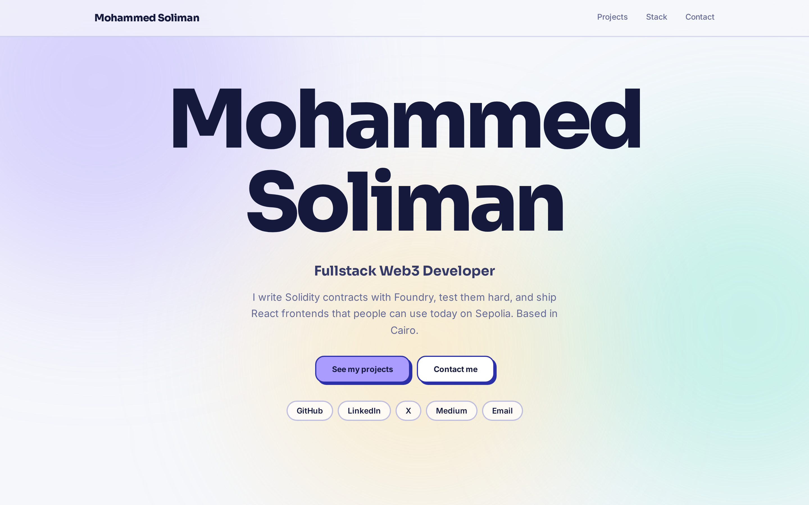
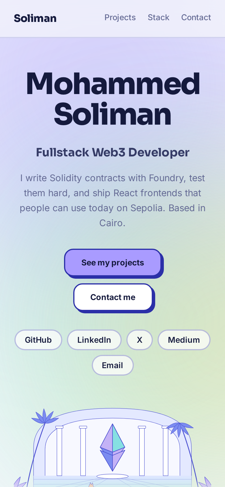

# Mohammed Soliman — Portfolio

Fullstack Web3 developer portfolio built with Next.js, React and Tailwind CSS — an ethereum.org-inspired illustrated theme with smooth scrolling, scroll reveals and a parallax hero.

[](https://soliman-portfolio-peach.vercel.app)
[](https://nextjs.org)
[](https://react.dev)
[](https://tailwindcss.com)
[](https://www.typescriptlang.org)
[](./LICENSE)
[](https://github.com/MohammedSoliman10/soliman-portfolio/actions/workflows/ci.yml)
[](https://vercel.com)



_Mobile view:_



## Features

- Ethereum.org-inspired illustrated theme with a hand-built SVG hero scene
- Smooth scrolling with scroll-padding for the sticky navbar
- Scroll reveals that trigger as sections enter the viewport
- Parallax hero where three illustration layers move at different speeds
- Scroll progress bar fixed to the top of the page
- Active nav highlighting driven by an IntersectionObserver
- Spotlight project cards that follow the cursor
- Fully responsive from 320px up to wide desktop
- Respects `prefers-reduced-motion` — all animation disables for users who ask for it

## Featured projects

Eight smart-contract builds, all tested with Foundry and deployed to Sepolia. Most have a live frontend you can try with a testnet wallet. Content lives in [`lib/data.ts`](lib/data.ts).

| Project | Stack | Live | Code |
| --- | --- | --- | --- |
| Tokenized Vault | Solidity, Foundry, React, wagmi, viem | [Demo](https://tokenized-vault.vercel.app) | [Repo](https://github.com/MohammedSoliman10/tokenized-vault) |
| Token Vesting | Solidity, Foundry, React, RainbowKit | [Demo](https://token-vesting-lyart.vercel.app) | [Repo](https://github.com/MohammedSoliman10/TokenVesting) |
| Dutch Auction | Solidity, ERC-721, IPFS | [Demo](https://dutch-auction-mu.vercel.app) | [Repo](https://github.com/MohammedSoliman10/dutch-auction) |
| English Auction | Solidity, Foundry, React | [Demo](https://english-auction-nine.vercel.app) | [Repo](https://github.com/MohammedSoliman10/english-auction) |
| Crowdfund | Solidity, ERC-20, React | [Demo](https://crowdfund-soliman11.vercel.app) | [Repo](https://github.com/MohammedSoliman10/crowdfund) |
| Escrow | Solidity, Foundry, React, wagmi | — | [Repo](https://github.com/MohammedSoliman10/escrow-smart-contract) |
| Soliman Web3 NFT | Solidity, ERC-721, IPFS | [Etherscan](https://sepolia.etherscan.io/address/0xc7f4550699371eabbc1b5b0aaf00007a0c46bcd5) | [Repo](https://github.com/MohammedSoliman10/erc721-foundry-soliman-nft) |
| ERC-20 Token dApp | Solidity, OpenZeppelin, wagmi, RainbowKit | [Demo](https://erc20-token-dapp.vercel.app/) | [Repo](https://github.com/MohammedSoliman10/erc20-token-dapp) |

## Tech stack

- **Framework:** Next.js 16 (App Router), React 19
- **Styling:** Tailwind CSS 4, self-hosted Sora + Inter variable fonts
- **Language:** TypeScript
- **Smart contracts:** Solidity, Foundry, OpenZeppelin
- **Web3 frontend:** wagmi, viem, RainbowKit
- **Deployment:** Vercel

## Getting started

Requires Node.js 20 or newer.

```bash
git clone https://github.com/MohammedSoliman10/soliman-portfolio.git
cd soliman-portfolio
npm install
npm run dev      # http://localhost:3000
```

### Scripts

| Command | Description |
| --- | --- |
| `npm run dev` | Start the development server |
| `npm run build` | Production build |
| `npm run start` | Serve the production build |
| `npm run lint` | Lint the code |

## Project structure

```
soliman-portfolio/
├── app/
│   ├── globals.css          # Tailwind + @theme design tokens and animations
│   ├── icon.svg             # Favicon (Ethereum diamond)
│   ├── apple-icon.png       # Apple touch icon (180x180)
│   ├── layout.tsx           # Root layout, metadata, fonts, background
│   └── page.tsx             # Home page composition
├── components/
│   ├── contact.tsx          # Contact call-to-action section
│   ├── footer.tsx           # Footer
│   ├── hero-scene.tsx       # Parallax Ethereum.org-style SVG illustration
│   ├── hero.tsx             # Hero with name entrance + parallax driver
│   ├── navbar.tsx           # Sticky nav with active-section highlighting
│   ├── projects.tsx         # Project grid
│   ├── reveal.tsx           # Scroll-reveal wrapper
│   ├── scroll-progress.tsx  # Top scroll progress bar
│   ├── section-heading.tsx  # Reusable section heading
│   ├── social-links.tsx     # Social link pills
│   ├── spotlight-card.tsx   # Cursor-following spotlight card
│   └── tech-stack.tsx       # Tech stack section
├── docs/
│   ├── screenshot.png       # Desktop screenshot
│   └── screenshot-mobile.png# Mobile screenshot
├── lib/
│   └── data.ts              # All site content (edit this to customize)
├── .github/workflows/ci.yml # CI: lint + build on push/PR to main
├── next.config.ts
├── postcss.config.mjs
└── tsconfig.json
```

## Customizing

All content lives in [`lib/data.ts`](lib/data.ts) — your name, bio, social links, the project list and the tech stack. Edit that one file and the whole site updates.

Colors and fonts are defined in the `@theme` block at the top of [`app/globals.css`](app/globals.css):

```css
@theme {
  --color-ink: #151a3d;
  --color-lav: #a99bff;
  --color-cyan: #5ee0c0;
  /* … */
}
```

Change a token there and it propagates everywhere it is used.

## Deployment

The site is deployed on [Vercel](https://vercel.com) and served at [soliman-portfolio-peach.vercel.app](https://soliman-portfolio-peach.vercel.app).

The Vercel project is connected to this GitHub repository, so every push to `main` triggers a production deployment and every pull request creates a preview deployment. To deploy your own fork, import the repo at [vercel.com/new](https://vercel.com/new) — the Next.js defaults work as-is.

## Contact

- [GitHub](https://github.com/MohammedSoliman10)
- [LinkedIn](https://linkedin.com/in/mohammed-soliman05)
- [X](https://x.com/MohammedSolly05)
- [Medium](https://medium.com/@mohammedsolly4)
- [mohammedsolly4@gmail.com](mailto:mohammedsolly4@gmail.com)

## License

Released under the [MIT License](LICENSE).
